# Esteira CI/CD para Azure

## OVERVIEW

**Proposta refinada de F002**, ainda sem workflows, recursos Azure ou testes de release executados. O aceite de F001 é local; bloqueios operacionais cloud impedem declarar prontidão de deployment.

## RELEASE FLOW

```mermaid
flowchart LR
  PR[Pull request] --> CI[Build e testes]
  CI --> MERGE[Merge protegido]
  MERGE --> IMG[Build e scan das imagens]
  IMG --> ACR[ACR e manifesto de digests]
  ACR --> DEV[Deploy dev e testes cloud]
  DEV --> GATE[Gate do ambiente prod]
  GATE --> PROD[Promover os mesmos digests]
  PROD --> CHECK[Smoke e métricas]
  CHECK --> RB[Rollback se necessário]
```

## WORKFLOWS PROPOSTOS

Os nomes abaixo são artefatos futuros, não arquivos existentes.

| Workflow | Gatilho | Responsabilidade e gate |
| --- | --- | --- |
| `ci.yml` | Pull request e push em main | Restore/build Release, Unit/Architecture e integração real com PostgreSQL/Redis; build dos cinco Dockerfiles sem push em PR |
| `infra.yml` | Dispatch ou merge que altera IaC | Lint/compile Bicep, validação e what-if; aplique por ambiente após análise de alterações destrutivas |
| `release.yml` | Merge protegido em main | Aguarde CI do mesmo SHA; publique imagens no ACR, manifesto e evidências; faça deploy dev e testes de broker/E2E |
| `promote.yml` | Dispatch de release validada | Verifique proveniência, CI, testes dev e autorização do ambiente; promova manifesto imutável para prod |
| `rollback.yml` | Dispatch de release anterior | Verifique compatibilidade de schema, restaure revisão/digest e confirme saúde; não reconstrua imagens |

REQUIRED: Use matriz para `Pix.CashOut.Api`, `Pix.Payment.Api`, `Outbank.Connector`, `Pix.Reconciliation.Worker` e `Webhook.Dispatcher`, com contexto de build na raiz. Uma mudança compartilhada exige validar todos os hosts dependentes.

REQUIRED: Separe publicação de infraestrutura, publicação de imagens e ativação de revisões. Mantenha um proprietário para cada configuração; updates de imagem não devem apagar escala, segredos ou probes definidos em Bicep.

## SECURITY

REQUIRED: Use **OIDC** com Microsoft Entra, credencial federada limitada ao repositório e ao GitHub Environment (`dev` ou `prod`). Use `contents: read` por padrão e `id-token: write` somente nos jobs Azure. Restrinja environments a branches protegidas. [OIDC Azure](https://docs.github.com/en/actions/how-tos/secure-your-work/security-harden-deployments/oidc-in-azure).

REQUIRED: Separe identidades para push ACR, deploy de aplicação e provisionamento/RBAC. Conceda menor privilégio no recurso ou resource group do ambiente; o job de deploy não deve atribuir roles. A criação inicial da federação/RBAC é bootstrap administrativo fora da identidade ordinária de release.

REQUIRED: Fixe actions por SHA completo e revise atualizações com Dependabot. Use runners efêmeros; mantenha código de PR sem credenciais Azure, permissão de push ou acesso a rede produtiva. PROHIBITED: Execute código de PR em `pull_request_target` com privilégios. [Secure use](https://docs.github.com/en/actions/reference/security/secure-use).

REQUIRED: Passe entradas não confiáveis por variáveis de ambiente e valide parâmetros de dispatch. Proteja main, exija CI e revisão para workflows/IaC. Verifique disponibilidade de revisores de Environment no plano GitHub; se indisponível, adote release por PR protegido com controles equivalentes documentados.

## ARTIFACTS

REQUIRED: Construa uma vez por commit, use tag SHA para rastreabilidade e **digest SHA-256 para deploy**. Promova os mesmos cinco digests entre ambientes. Não use `latest`. [Publicação de imagens existentes](https://learn.microsoft.com/en-us/azure/container-apps/github-actions).

REQUIRED: Gere SBOM, scan de dependências/imagens e proveniência; bloqueie vulnerabilidades críticas/altas sem exceção revisada, justificada e com expiração. Verifique a origem do manifesto antes da promoção. Use base images por digest, usuário não root e `.dockerignore` para impedir cópia de segredos/contexto desnecessário.

REQUIRED: Armazene manifesto com commit, run ID, digests, versão de schema, parâmetros não secretos e revisões geradas. Guarde resultados de testes e scans por 30 dias inicialmente; preserve manifesto e imagens dos últimos 10 releases e por pelo menos 90 dias. Estes períodos são proposta operacional.

## DEPLOYMENT AND FAILURE

1. REQUIRED: Valide configuração, quotas, permissões, endpoints de rede e bloqueios de runtime antes de provisionar.
2. REQUIRED: Execute Bicep/what-if com parâmetros por ambiente e budget/alertas; não recrie dados em release ordinária.
3. REQUIRED: Execute migration como job finito exclusivo, com timeout e identidade própria, após backup validado. Use expand/contract compatível com revisão anterior; não migre em cada startup.
4. REQUIRED: Publique APIs como revisão candidata, teste label de revisão e avance tráfego de forma controlada. Defina janela/limiar de promoção no ambiente antes de executar.
5. REQUIRED: Atualize workers com uma revisão ativa e shutdown seguro. O peso HTTP não controla consumo de filas. Reconcilie falhas parciais entre os cinco apps pelo manifesto.
6. REQUIRED: Em falha de smoke/saúde, interrompa promoção, preserve logs e volte à revisão/digest anterior. Não reverta schema automaticamente; rollback de código depende de compatibilidade previamente testada.

REQUIRED: Serialize deploys por ambiente com `concurrency` e `cancel-in-progress: false`; permita cancelamento de CI antigo em PR. Configure timeouts em todos os jobs. Um workflow cancelado/falho deve permitir retomada idempotente sem duas migrations concorrentes.

## ACCEPTANCE

| Cenário | Evidência exigida |
| --- | --- |
| PR externo | Testes executam; nenhuma credencial Azure ou publicação é obtida |
| CI ou scan falha | Release não é publicado/promovido |
| OIDC de branch/ambiente errado | Login Azure negado |
| Promoção | Digests dev/prod iguais ao manifesto validado |
| Migration falha | Nenhuma nova revisão recebe tráfego produtivo |
| Release parcial ou cancelado | Retomada/rollback recupera os cinco hosts sem migration duplicada |
| Revisão sem readiness | Promoção bloqueada e revisão anterior mantém atendimento |
| Rollback | Release anterior recuperado sem nova build; dados permanecem compatíveis |

## REFERENCES

- [ARCHITECTURE.md](./ARCHITECTURE.md): Base arquitetural do projeto.
- [TESTS.md](./TESTS.md): Metas e comandos de testes existentes; resultados não revalidados nesta tarefa.
- [CONTAINER-APPS.md](./CONTAINER-APPS.md): Runtime, escala e operação do destino.
- [plataforma_pix.md](../feature/plataforma_pix.md): Domínio Pix modernizado e implementado.
