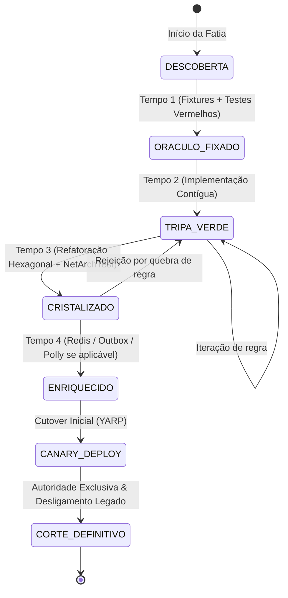

# Lifecycle & State Machine da Fatia de Migração

Este documento define a **máquina de estados determinística**, os **gates de transição** e o **schema de handoff** para cada fatia vertical no processo de modernização.

---

## 1. Diagrama de Estados da Fatia



---

## 2. Tabela de Transições e Gates de Qualidade

| Estado Atual | Próximo Estado | Gatilho / Responsável | Evidência Obrigatória no Gate |
| :--- | :--- | :--- | :--- |
| `DESCOBERTA` | `ORACULO_FIXADO` | Especialista em Legado / Oráculo | Testes de caracterização passam no **Legado**; testes comitados no novo repo e rodam **VERMELHOS** por ausência de implementação. Fixtures sanitizadas. |
| `ORACULO_FIXADO` | `TRIPA_VERDE` | Implementador da Fatia | 100% dos testes de contrato passam no novo repo (**VERDES**). SQL parametrizado comprovado. Exceção de tripa registrada no manifesto. |
| `TRIPA_VERDE` | `CRISTALIZADO` | Arquiteto de Cristalização | Código decomposto em Domain/Application/Infra. Testes de contrato continuam **VERDES** sem alteração de asserções. `NetArchTest` 100% verde. Exceção de tripa removida. |
| `CRISTALIZADO` | `ENRIQUECIDO` | Engenheiro de Plataforma / Infra | Testes de integração de componentes extras (Redis, Outbox, Service Bus) aprovados. Testes de caos/timeout Polly aprovados. |
| `ENRIQUECIDO` | `CANARY_DEPLOY` | Engenheiro de Transição & Operação | Deploy em Hml/Prod isolado com trace Dynatrace aprovado. Roteamento do YARP ativo para coorte restrita com autoridade única. |
| `CANARY_DEPLOY` | `CORTE_DEFINITIVO` | Orquestrador & Líder Técnico | Reconciliação de dados completa; zero erros no Dynatrace; rota e código antigo desativados no legado. |

---

## 3. Travas Inegociáveis de CI/CD

1. **Bloqueio de Tripa em Ambientes Compartilhados:**
   - O pipeline de CI/CD inspeciona a presença de tags/anotações `[TemporarySliceException]` ou estado diferente de `CRISTALIZADO` no `slice.json`.
   - Se uma fatia estiver em estado `TRIPA_VERDE`, o pipeline **permite build e execução local/Dev**, mas **ABORTA AUTOMATICAMENTE** qualquer promoção para Homologação ou Produção.
2. **Imutabilidade do Oráculo no Tempo 3:**
   - Durante a transição de `TRIPA_VERDE` para `CRISTALIZADO`, o Git Diff é inspecionado. Qualquer modificação nos arquivos dentro de `tests/Contracts/` invalida o gate imediatamente. O oráculo é imutável.

---

## 4. Schema Formal de Handoff (`handoff.json`)

Nenhum agente entrega trabalho para o próximo por linguagem natural. A entrega é auditada por este artefato na raiz da fatia:

```json
{
  "$schema": "http://json-schema.org/draft-07/schema#",
  "title": "SliceHandoffArtifact",
  "type": "object",
  "required": [
    "slice_id",
    "source_state",
    "target_state",
    "agent_role",
    "commit_hash",
    "oracle_contract_hash",
    "modified_files",
    "test_execution",
    "architecture_compliance",
    "open_questions"
  ],
  "properties": {
    "slice_id": {
      "type": "string",
      "description": "Identificador único da fatia (ex: SLICE-001-COBRANCA-EMISSAO)"
    },
    "source_state": {
      "type": "string",
      "enum": ["DESCOBERTA", "ORACULO_FIXADO", "TRIPA_VERDE", "CRISTALIZADO", "ENRIQUECIDO", "CANARY_DEPLOY"]
    },
    "target_state": {
      "type": "string",
      "enum": ["ORACULO_FIXADO", "TRIPA_VERDE", "CRISTALIZADO", "ENRIQUECIDO", "CANARY_DEPLOY", "CORTE_DEFINITIVO"]
    },
    "agent_role": {
      "type": "string",
      "description": "Papel do agente executor (ex: LegacyOracle, SliceImplementer, Crystallizer)"
    },
    "commit_hash": {
      "type": "string",
      "description": "Hash SHA do commit no repositório correspondente"
    },
    "oracle_contract_hash": {
      "type": "string",
      "description": "Hash SHA256 do arquivo de teste de contrato para garantir imutabilidade"
    },
    "modified_files": {
      "type": "array",
      "items": { "type": "string" },
      "description": "Caminhos relativos de todos os arquivos tocados nesta fase"
    },
    "test_execution": {
      "type": "object",
      "required": ["total", "passed", "failed", "evidence_log_path"],
      "properties": {
        "total": { "type": "integer" },
        "passed": { "type": "integer" },
        "failed": { "type": "integer" },
        "evidence_log_path": { "type": "string" }
      }
    },
    "architecture_compliance": {
      "type": "object",
      "required": ["netarchtest_passed", "temporary_exceptions"],
      "properties": {
        "netarchtest_passed": { "type": "boolean" },
        "temporary_exceptions": {
          "type": "array",
          "items": { "type": "string" }
        }
      }
    },
    "open_questions": {
      "type": "array",
      "items": { "type": "string" },
      "description": "Dúvidas ou divergências de negócio registradas para validação humana"
    }
  }
}
```
