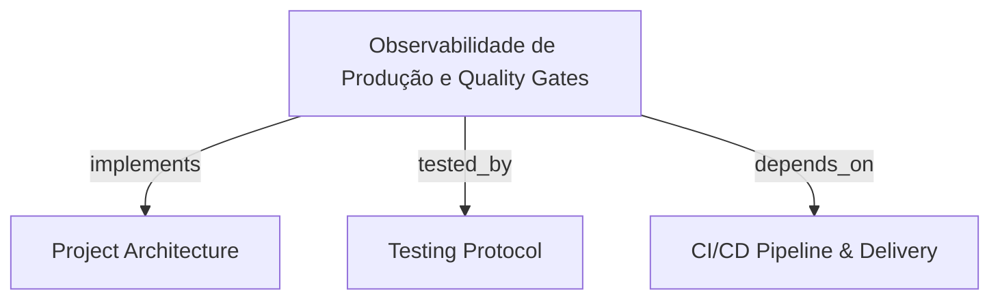

```graph
{"node_id":"feature:observabilidade-dynatrace","domain":"observabilidade_dynatrace","implements":["adr:architecture"],"tested_by":["adr:tests"],"entrypoints":["src/Pix.CashOut.Api/Program.cs","src/Pix.Payment.Api/Program.cs",".github/workflows/promote-hml.yml",".github/workflows/promote-prod.yml"],"registration_files":["src/Pix.Processing.Infrastructure/Telemetry/OtlpTelemetryConfiguration.cs","src/Pix.Processing.Domain/Telemetry/IDynatraceGuardianClient.cs"],"reference_files":["src/Pix.Processing.Domain/Telemetry/ContextoW3C.cs","src/Pix.Processing.Domain/Telemetry/LaudoGuardian.cs","src/Pix.Processing.Domain/Telemetry/SanitizadorTelemetriaPolicy.cs","src/Pix.Processing.Infrastructure/Telemetry/DynatraceGuardianClient.cs"],"code_files":["src/Pix.Processing.Domain/Telemetry/MetricasGoldenSignals.cs","src/Pix.Processing.Domain/Telemetry/VereditoQualityGate.cs","src/Pix.Processing.Domain/Telemetry/IdentificadorTecnico.cs","src/Pix.Processing.Domain/Telemetry/InspecaoBakePeriod.cs","src/Pix.Processing.Domain/Entities/MensagemOutbox.cs","src/Pix.Processing.Infrastructure/Repositories/OutboxRepository.cs","src/Pix.Processing.Infrastructure/Adapters/AcceptanceStore.cs","src/Pix.Processing.Infrastructure/Adapters/ExecutionStore.cs","src/Pix.Processing.Infrastructure/Adapters/OutboxAndAuthAdapters.cs","src/Outbank.Connector/PaymentExecutionWorker.cs"],"test_files":["tests/Unit/TelemetryTests.cs"],"knowledge":{"schema_version":1,"entities":[{"id":"capability:w3c-trace-propagation","type":"capability","label":"W3C Trace Propagation","definition":"Distributed trace context propagation across HTTP APIs, Outbox, and Service Bus sessions via W3C Trace Context.","aliases":[]},{"id":"capability:dynatrace-srg-quality-gate","type":"capability","label":"Dynatrace SRG Quality Gate","definition":"Site Reliability Guardian quality gate evaluation of SDLC release events against Golden Signals and SLO thresholds.","aliases":[]},{"id":"capability:davis-ai-bake-monitoring","type":"capability","label":"Davis AI Bake Monitoring","definition":"Automated bake period anomaly detection and circuit breaker powered by Dynatrace Davis AI root cause analysis.","aliases":[]},{"id":"capability:pii-telemetry-sanitization","type":"capability","label":"PII Telemetry Sanitization","definition":"Strict sanitization of PII and sensitive data from OpenTelemetry activities and tags, retaining only authorized technical identifiers.","aliases":[]},{"id":"rule:w3c-format-and-nonzero-id","type":"rule","label":"W3C Format and Nonzero ID","definition":"TraceParent must be 55 characters in format 00-{traceId}-{spanId}-{flags} with non-zero traceId and spanId.","aliases":[]},{"id":"rule:golden-signals-invariants","type":"rule","label":"Golden Signals Invariants","definition":"P99 latency >= P95 latency, error rate between 0.0% and 100.0%, non-negative finite throughput and latency, and BACEN SLA <= 2000ms.","aliases":[]},{"id":"rule:sealed-guardian-report-immutability","type":"rule","label":"Guardian Report Immutability","definition":"LaudoGuardian becomes permanently immutable once marked as Concluido, rejecting further modifications.","aliases":[]},{"id":"rule:pii-data-redaction","type":"rule","label":"PII Data Redaction","definition":"Telemetry tags must not contain PII (CPF, email, phone, account) or sensitive keys, retaining only PedidoId and 32-char BACEN EndToEndId.","aliases":[]},{"id":"rule:fail-closed-guardian-promotion","type":"rule","label":"Fail-Closed Guardian Promotion","definition":"Missing credentials or non-PASS Dynatrace SRG verdict in HML blocks promotion to Production.","aliases":[]},{"id":"contract:w3c-trace-headers","type":"contract","label":"W3C Trace Headers","definition":"W3C Trace Context HTTP and messaging contract exchanging traceparent and tracestate headers.","aliases":[]},{"id":"contract:guardian-evaluation-api","type":"contract","label":"Guardian Evaluation API","definition":"Dynatrace SRG evaluation API contract sending EventoSDLC payload and receiving LaudoGuardian with SLO violations.","aliases":[]},{"id":"contract:davis-problems-api","type":"contract","label":"Davis Problems API","definition":"Dynatrace Problems API v2 contract querying open problems during the bake period.","aliases":[]},{"id":"decision:otlp-batch-export","type":"decision","label":"OTLP Batch Export","definition":"Export telemetry via OpenTelemetry OTLP standard protocol with bounded batch queue.","aliases":[]}],"claims":[{"id":"claim:w3c-regex-and-nonzero-guard","subject":"capability:w3c-trace-propagation","relation":"constrained_by","object":"rule:w3c-format-and-nonzero-id","statement":"ContextoW3C validates 55-char format and rejects all-zero traceId or spanId per W3C specification.","kind":"observation","status":"supported","evidence":[{"kind":"code","source":"src/Pix.Processing.Domain/Telemetry/ContextoW3C.cs","locator":"ContextoW3C.Create validation logic","snapshot":null}],"derived_from":[],"gap":null},{"id":"claim:golden-signals-invariants-guard","subject":"capability:dynatrace-srg-quality-gate","relation":"constrained_by","object":"rule:golden-signals-invariants","statement":"MetricasGoldenSignals enforces finite non-negative values, error rate 0-100%, and P99 >= P95 invariant.","kind":"observation","status":"supported","evidence":[{"kind":"code","source":"src/Pix.Processing.Domain/Telemetry/MetricasGoldenSignals.cs","locator":"MetricasGoldenSignals constructor invariants","snapshot":null}],"derived_from":[],"gap":null},{"id":"claim:guardian-immutability-guard","subject":"capability:dynatrace-srg-quality-gate","relation":"constrained_by","object":"rule:sealed-guardian-report-immutability","statement":"LaudoGuardian rejects modifications once evaluation status is Concluido.","kind":"observation","status":"supported","evidence":[{"kind":"code","source":"src/Pix.Processing.Domain/Telemetry/LaudoGuardian.cs","locator":"ConcluirAvaliacao status check","snapshot":null}],"derived_from":[],"gap":null},{"id":"claim:pii-sanitization-guard","subject":"capability:pii-telemetry-sanitization","relation":"constrained_by","object":"rule:pii-data-redaction","statement":"SanitizadorTelemetriaPolicy strips sensitive keys and PII patterns while preserving PedidoId and EndToEndId.","kind":"observation","status":"supported","evidence":[{"kind":"code","source":"src/Pix.Processing.Domain/Telemetry/SanitizadorTelemetriaPolicy.cs","locator":"AplicarTagsSeguras and SanitizarTags methods","snapshot":null}],"derived_from":[],"gap":null},{"id":"claim:fail-closed-guardian-promotion-guard","subject":"capability:dynatrace-srg-quality-gate","relation":"constrained_by","object":"rule:fail-closed-guardian-promotion","statement":"promote-hml.yml workflow blocks promotion when Dynatrace SRG verdict is not PASS or credentials are missing.","kind":"observation","status":"supported","evidence":[{"kind":"configuration","source":".github/workflows/promote-hml.yml","locator":"Dynatrace Site Reliability Guardian Quality Gate step","snapshot":null}],"derived_from":[],"gap":null},{"id":"claim:trace-headers-contract-exposes","subject":"capability:w3c-trace-propagation","relation":"exposes","object":"contract:w3c-trace-headers","statement":"PaymentExecutionWorker and API middleware exchange and propagate traceparent and tracestate headers.","kind":"observation","status":"supported","evidence":[{"kind":"code","source":"src/Outbank.Connector/PaymentExecutionWorker.cs","locator":"ProcessSessionMessageInternalAsync traceparent extraction","snapshot":null}],"derived_from":[],"gap":null},{"id":"claim:guardian-evaluation-contract-exposes","subject":"capability:dynatrace-srg-quality-gate","relation":"exposes","object":"contract:guardian-evaluation-api","statement":"DynatraceGuardianClient dispatches EventoSDLC to /api/v2/guardians/evaluations and returns LaudoGuardian.","kind":"observation","status":"supported","evidence":[{"kind":"code","source":"src/Pix.Processing.Infrastructure/Telemetry/DynatraceGuardianClient.cs","locator":"DispararAvaliacaoAsync and ConsultarLaudoAsync","snapshot":null}],"derived_from":[],"gap":null},{"id":"claim:davis-problems-contract-exposes","subject":"capability:davis-ai-bake-monitoring","relation":"exposes","object":"contract:davis-problems-api","statement":"promote-prod.yml queries /api/v2/problems for open problems during the 10-minute bake period.","kind":"observation","status":"supported","evidence":[{"kind":"configuration","source":".github/workflows/promote-prod.yml","locator":"Deploy Blue/Green APIs with 10-Minute Bake Window step","snapshot":null}],"derived_from":[],"gap":null},{"id":"claim:otlp-export-decision","subject":"capability:w3c-trace-propagation","relation":"governed_by","object":"decision:otlp-batch-export","statement":"Telemetry pipeline uses OtlpTelemetryConfiguration with bounded batch processor options.","kind":"observation","status":"supported","evidence":[{"kind":"code","source":"src/Pix.Processing.Infrastructure/Telemetry/OtlpTelemetryConfiguration.cs","locator":"ObterOpcoesPadrao configuration","snapshot":null}],"derived_from":[],"gap":null}]}}
```

# Observabilidade de Produção e Quality Gates com Dynatrace

Rastreabilidade distribuída ponta a ponta com contexto W3C, sanitização de dados sensíveis e gates automatizados via Dynatrace SRG e Davis AI.

## OVERVIEW
Implementação de observabilidade enterprise para a plataforma Pix integrando OpenTelemetry (OTLP) e Dynatrace. Garante propagação de contexto W3C (`traceparent`, `tracestate`) em APIs HTTP, persistência transacional de Outbox e filas do Azure Service Bus, combinando expurgo obrigatório de dados pessoais (PII/LGPD), validação de Golden Signals contra SLAs regulatórios do BACEN e gates de promoção contínua com detecção de anomalias em tempo real.

## FOLDER STRUCTURE
<folder_structure>
```
src/
├── Pix.Processing.Domain/
│   └── Telemetry/              # Value objects W3C, Golden Signals, laudo Guardian e políticas PII
├── Pix.Processing.Infrastructure/
│   └── Telemetry/              # Cliente HTTP Dynatrace Guardian e configuração OTLP
├── *.Api/                      # Middleware de propagação W3C e sanitização de tags
└── Outbank.Connector/          # Propagação de contexto de rastreio em sessões Service Bus
```
</folder_structure>

## KEY MECHANISMS
- **W3C Distributed Trace Propagation**: Propagação contínua de `traceparent` (55 caracteres) e `tracestate` através de chamadas HTTP, colunas de banco em `[pix].[OutboxRecords]` e mensagens do Azure Service Bus. Rejeita IDs nulos (`00000000000000000000000000000000`).
- **PII Telemetry Sanitization Policy**: Filtro rigoroso eliminando dados pessoais e segredos (CPF, e-mail, telefone, agência, conta, tokens) de traces e logs antes da exportação, retendo apenas correlações técnicas (`pedido_id`, `end_to_end_id`).
- **Dynatrace Site Reliability Guardian (SRG)**: Quality gate em ambiente de Homologação avaliando Golden Signals (Latência P95 <= 400ms, Erro <= 0.1%, SLA BACEN SPI <= 2000ms). Veredito não-PASS aborta a esteira em regime fail-closed.
- **Davis AI Bake Period Circuit Breaker**: Monitoramento ativo durante a janela de bake de 10 minutos em Produção (canary 10%). Detecção de problemas abertos ou violação de SLO aborta o rollout e aciona rollback automático.

## HOW TO OPERATE QUALITY GATES & TELEMETRY

### Prerequisites
1. OpenTelemetry Collector ou Dynatrace ActiveGate acessível via OTLP na porta 4318.
2. Segredos `DYNATRACE_ENVIRONMENT_URL` e `DYNATRACE_API_TOKEN` configurados no GitHub Actions.

### Steps
1. Configurar variáveis de exportação OTLP no ambiente da aplicação.
2. Propagar cabeçalho `traceparent` nas requisições HTTP de entrada.
3. Executar o workflow de promoção para Homologação (`promote-hml.yml`) acionando a avaliação do SRG.
4. Monitorar a janela de bake no workflow de Produção (`promote-prod.yml`).

<code_example>
# CORRECT: Sanitização de tags e injeção de identificadores técnicos autorizados
var ids = IdentificadorTecnico.Validar(pedido.Id, pedido.EndToEndId.Valor);
SanitizadorTelemetriaPolicy.AplicarTagsSeguras(Activity.Current, ids);

# WRONG: Injeção direta de dados sensíveis ou PII em spans de telemetria
Activity.Current?.SetTag("cpf", cliente.Cpf);
Activity.Current?.SetTag("chave_pix", cliente.Email);
</code_example>

## PARAMETERS / CONFIGURATIONS

| Parâmetro | Tipo | Obrigatório | Descrição | Padrão |
|-----------|------|-------------|-------------|--------|
| `OTEL_EXPORTER_OTLP_ENDPOINT` | string | Sim | Endpoint de exportação OTLP HTTP do Dynatrace | `http://localhost:4318` |
| `DYNATRACE_API_TOKEN` | string | Sim | Token de autenticação da API Dynatrace com escopos de Guardian e Problems | — |
| `OTEL_SERVICE_NAME` | string | Não | Nome do serviço reportado nos traces | `Pix.Processing` |
| `DYNATRACE_SIMULATE_MODE` | bool | Não | Habilita bypass simulado do Guardian exclusivamente para testes de CI | `false` |

## BEST PRACTICES
REQUIRED: Sanitizar todas as tags de Activity com `SanitizadorTelemetriaPolicy` antes de exportar spans para observabilidade.
REQUIRED: Rejeitar identificadores técnicos contendo formato de CPF, e-mail ou prefixos BACEN fora do padrão de 32 caracteres.
REQUIRED: Manter política fail-closed em gates de Homologação na ausência de credenciais do Dynatrace.
PROHIBITED: Permitir avanço de release em Produção quando o Dynatrace Davis AI registrar problemas abertos durante o bake window.

## TIPS

<code_tip>
// Configuração padronizada de exportador OTLP em lote com filas limitadas em memória
var options = OtlpTelemetryConfiguration.ObterOpcoesPadrao();
// Garante retenção máxima de 2048 spans e lotes de exportação de 512 itens
</code_tip>

## DOCUMENT MAP



## REFERENCES

- [**ARCHITECTURE.md**](../adr/ARCHITECTURE.md): Arquitetura hexagonal, persistência outbox e governança de telemetria.
- [**TESTS.md**](../adr/TESTS.md): Protocolo de testes unitários e validações de cenários de observabilidade.
- [**cicd_pipeline.md**](./cicd_pipeline.md): Esteira de CI/CD automatizada com gates manuais e verificação de bake window.
