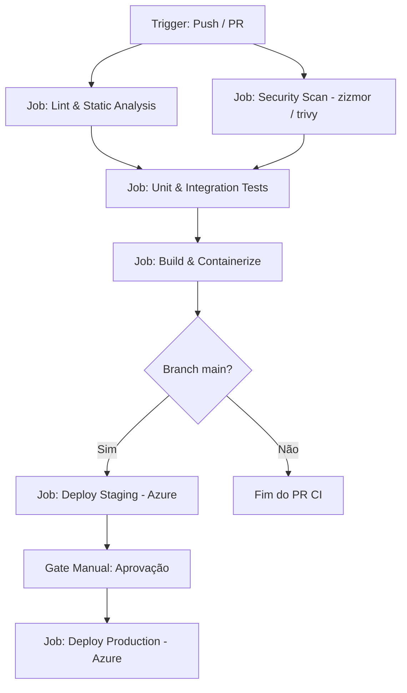

# Criação e Scaffolding de Pipelines no GitHub Actions

> Metodologias, padrões de agentes e ferramentas para gerar esteiras de CI/CD robustas, modulares e preparadas para ambientes em nuvem (com foco em Azure).

---

## 1. O Processo de Scaffolding Orientado a Sinais (Stack Detection)

Em vez de criar arquivos de workflow genéricos por adivinhação, as skills de engenharia do GitHub Actions (como o `ci-cd-pipeline-builder` do `alirezarezvani/claude-skills`) utilizam **detecção de sinais de stack**.

O agente inspeciona os arquivos raiz e os manifestos de dependência do projeto:

| Arquivo Detectado | Tecnologia / Runtime | Gerenciador de Pacotes | Ações Recomendadas de Setup & Cache |
| :--- | :--- | :--- | :--- |
| `package.json` + `package-lock.json` | Node.js | `npm` | `actions/setup-node@v4` com `cache: 'npm'` |
| `package.json` + `pnpm-lock.yaml` | Node.js | `pnpm` | `pnpm/action-setup` + `setup-node` com `cache: 'pnpm'` |
| `package.json` + `yarn.lock` | Node.js | `yarn` | `actions/setup-node@v4` com `cache: 'yarn'` |
| `*.csproj` / `*.sln` | .NET 8/9 / C# | `dotnet` / `nuget` | `actions/setup-dotnet@v4` com `cache: true` |
| `requirements.txt` / `poetry.lock` | Python | `pip` / `poetry` | `actions/setup-python@v5` com `cache: 'pip'` ou `'poetry'` |
| `go.mod` + `go.sum` | Go | `go modules` | `actions/setup-go@v5` com `cache: true` |
| `Cargo.toml` + `Cargo.lock` | Rust | `cargo` | `actions/cache` para `~/.cargo` e `target/` |
| `pom.xml` / `build.gradle` | Java | `maven` / `gradle` | `actions/setup-java@v4` com `cache: 'maven'` ou `'gradle'` |
| `*.bicep` / `main.bicep` | Azure IaC | `azure-cli` | `azure/bicep-build-action` ou validação CLI |
| `Dockerfile` / `docker-compose.yml` | Containers | `docker` | `docker/setup-buildx-action` + `docker/build-push-action` |

### Script Auxiliar de Detecção de Stack (Python)
As skills de criação frequentemente incluem um script Python leve que o agente invoca no terminal:

```python
#!/usr/bin/env python3
"""stack_detector.py - Detecta a stack e sugere comandos de CI."""
from pathlib import Path
import json

def detect_stack(repo_path="."):
    root = Path(repo_path)
    signals = {}
    
    if (root / "package.json").exists():
        signals["language"] = "javascript/typescript"
        if (root / "pnpm-lock.yaml").exists():
            signals["package_manager"] = "pnpm"
            signals["install_cmd"] = "pnpm install --frozen-lockfile"
            signals["test_cmd"] = "pnpm test"
        elif (root / "package-lock.json").exists():
            signals["package_manager"] = "npm"
            signals["install_cmd"] = "npm ci"
            signals["test_cmd"] = "npm test"
            
    elif any(root.glob("*.csproj")) or any(root.glob("*.sln")):
        signals["language"] = "csharp/.net"
        signals["package_manager"] = "dotnet"
        signals["install_cmd"] = "dotnet restore"
        signals["test_cmd"] = "dotnet test --no-restore --verbosity normal"
        signals["build_cmd"] = "dotnet build --configuration Release --no-restore"
        
    elif (root / "requirements.txt").exists() or (root / "pyproject.toml").exists():
        signals["language"] = "python"
        signals["package_manager"] = "poetry" if (root / "poetry.lock").exists() else "pip"
        signals["test_cmd"] = "pytest"
        
    if any(root.rglob("*.bicep")):
        signals["iac"] = "azure-bicep"
        
    if (root / "Dockerfile").exists():
        signals["container"] = True
        
    return signals

if __name__ == "__main__":
    print(json.dumps(detect_stack(), indent=2))
```

---

## 2. Padrão Arquitetural de Estágios de CI/CD

Uma esteira empresarial robusta deve ser dividida em **jobs desacoplados**, permitindo execução em paralelo e isolamento de falhas:



### Regras Essenciais de Jobs:
1. **Nome Descritivo & ID semântico:** IDs como `lint`, `test`, `build_image`, `deploy_prod`.
2. **Dependências explícitas (`needs`):** Garante que o deploy só inicie após o build e os testes passarem.
3. **Outputs entre Jobs:** Usar `$GITHUB_OUTPUT` para repassar tags de imagens, digests e caminhos de artefatos.

---

## 3. Padrão de Integração com Azure Cloud (Keyless OIDC)

> [!IMPORTANT]
> **Nunca use segredos estáticos de longo prazo** (como senhas de Service Principal ou conexões cruas) nas GitHub Actions. O padrão recomendado para Azure é **OIDC (OpenID Connect) / Workload Identity Federation**.

### Como funciona:
1. O GitHub Actions gera um token JWT assinado criptograficamente com informações do repositório, branch e ambiente (`id-token: write`).
2. O Microsoft Entra ID (Azure AD) valida o token contra a Credencial Federada configurada no Service Principal ou Managed Identity.
3. O runner recebe um Access Token temporário do Azure Resource Manager sem que nenhuma credencial tenha sido armazenada como segredo fixo.

### Exemplo de Autenticação OIDC Segura no Azure:

```yaml
permissions:
  id-token: write   # Obrigatório para solicitar o token JWT OIDC
  contents: read    # Mínimo necessário para clonar o código

jobs:
  deploy-azure:
    runs-on: ubuntu-latest
    environment: production
    steps:
      - name: Checkout
        uses: actions/checkout@11bd71901bbe5b1630ceea73d27597364c9af683 # v4.2.2
        with:
          persist-credentials: false

      - name: Login via Azure OIDC
        uses: azure/login@a65d910e8ad852c80617db239f1a4e15779c11a3 # v2.2.0
        with:
          client-id: ${{ secrets.AZURE_CLIENT_ID }}
          tenant-id: ${{ secrets.AZURE_TENANT_ID }}
          subscription-id: ${{ secrets.AZURE_SUBSCRIPTION_ID }}

      - name: Deploy Azure Bicep
        uses: azure/arm-deploy@a49c95b6c37ab6a7a51c7aa78ad4e97669d67fb8 # v2.0.0
        with:
          subscriptionId: ${{ secrets.AZURE_SUBSCRIPTION_ID }}
          resourceGroupName: 'rg-pix-production-brazilsouth'
          template: './infra/main.bicep'
          parameters: './infra/parameters.prod.json'
```

---

## 4. Reusable Workflows (`workflow_call`) vs Composite Actions

Para evitar duplicar dezenas de linhas de YAML em múltiplos repositórios ou workflows, os agentes de criação empregam dois mecanismos do GitHub:

### Comparativo:

| Característica | Reusable Workflow (`workflow_call`) | Composite Action (`using: "composite"`) |
| :--- | :--- | :--- |
| **Localização** | `.github/workflows/meu-reutilizavel.yml` | `actions/minha-action/action.yml` |
| **Escopo** | Orquestra um ou múltiplos **jobs** completos | Encapsula múltiplos **steps** dentro de um único job |
| **Secrets** | Passados via `secrets:` ou `secrets: inherit` | Acessa variáveis de ambiente do job pai |
| **Ambientes** | Pode definir seu próprio `environment` e runners | Roda dentro do runner e ambiente do job invocador |
| **Uso Ideal** | Padronização corporativa de esteiras CI/CD inteiras | Scripts utilitários reutilizáveis (ex.: setup de ferramentas) |

---

## 5. Template Canônico de CI/CD para Aplicações Corporativas

Abaixo está o modelo de referência gerado por skills de alta fidelidade:

```yaml
name: CI/CD Pipeline

on:
  push:
    branches: [main]
  pull_request:
    branches: [main]
  workflow_dispatch:

# Previne que pushes sucessivos na mesma PR acumulem execuções simultâneas
concurrency:
  group: ${{ github.workflow }}-${{ github.ref }}
  cancel-in-progress: true

# Princípio do menor privilégio por padrão
permissions:
  contents: read

jobs:
  validate:
    name: Lint & Static Code Analysis
    runs-on: ubuntu-latest
    steps:
      - name: Checkout Code
        uses: actions/checkout@11bd71901bbe5b1630ceea73d27597364c9af683 # v4.2.2
        with:
          persist-credentials: false

      - name: Setup .NET
        uses: actions/setup-dotnet@3951f0dfe7a07e2313ec93c75700083e200f3c89 # v4.3.0
        with:
          dotnet-version: '8.0.x'
          cache: true

      - name: Restore Dependencies
        run: dotnet restore

      - name: Code Formatting Check
        run: dotnet format --verify-no-changes --verbosity normal

  test:
    name: Unit & Integration Tests
    needs: validate
    runs-on: ubuntu-latest
    steps:
      - name: Checkout Code
        uses: actions/checkout@11bd71901bbe5b1630ceea73d27597364c9af683 # v4.2.2
        with:
          persist-credentials: false

      - name: Setup .NET
        uses: actions/setup-dotnet@3951f0dfe7a07e2313ec93c75700083e200f3c89 # v4.3.0
        with:
          dotnet-version: '8.0.x'
          cache: true

      - name: Run Tests with Coverage
        run: dotnet test --no-restore --collect:"XPlat Code Coverage"
```

