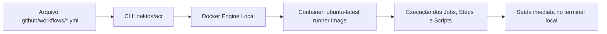

# Execução Local e Testes de Pipelines no GitHub Actions

> Estratégias e ferramentas para simular, testar e depurar workflows em ambiente local sem depender de commits e ciclos lentos no GitHub.

---

## 1. O Problema do Ciclo "Git Commit & Pray"

O método ingênuo de desenvolvimento de pipelines segue o padrão:
1. Altera o YAML.
2. Faz `git commit -m "fix pipeline" && git push`.
3. Aguarda 3 a 7 minutos pelo runner remoto.
4. Descobre um erro de digitação ou variável ausente.
5. Repete o processo gerando poluição no histórico do Git e desperdício de minutos de CI.

As boas práticas de engenharia e as **Skills de teste** preconizam testes locais e validações determinísticas antes do push.

---

## 2. Execução Local com `nektos/act`

* **Repositório:** [`nektos/act`](https://github.com/nektos/act)
* **Requisito:** Docker Desktop / Docker Engine instalado na máquina.

O `act` lê os arquivos em `.github/workflows/`, monta o repositório dentro de um container Docker correspondente à imagem do runner do GitHub (`ubuntu-latest`) e executa os passos exatamente como a infraestrutura do GitHub faria.



### Instalação:
```bash
# Windows (via Chocolatey ou Scoop)
choco install act-cli
# ou
scoop install act

# macOS
brew install act

# Linux
curl -s https://raw.githubusercontent.com/nektos/act/master/install.sh | sudo bash
```

### Comandos Essenciais do `act`:
```bash
# Listar todos os jobs e eventos mapeados no repositório
act -l

# Simular um evento de Pull Request (executa apenas jobs disparados por pull_request)
act pull_request

# Executar um job específico pelo ID
act -j test

# Executar em modo Dry-Run (valida sintaxe e mapeamento sem rodar os containers)
act -n

# Passar segredos locais para a execução
act --secret AZURE_CLIENT_ID="meu-client-id" --secret-file .env.local

# Usar imagem completa do Ubuntu para evitar ferramentas ausentes
act -P ubuntu-latest=catthehacker/ubuntu:act-latest
```

### Simulação de Payloads de Eventos:
Para testar como seu workflow reage a títulos de PR ou labels específicas, crie um arquivo `event.json` simulado:
```json
{
  "pull_request": {
    "title": "feat: adiciona validacao de pix",
    "head": {
      "ref": "feature/pix-val"
    },
    "base": {
      "ref": "main"
    }
  }
}
```
E invoque com:
```bash
act pull_request -e event.json
```

---

## 3. Testes Unitários de Composite Actions e Scripts com `bats-core`

* **Repositório:** [`bats-core/bats-core`](https://github.com/bats-core/bats-core)
* **Objetivo:** Framework de teste automatizado para scripts Bash e composite actions.

Se a sua esteira ou composite action contém lógica não trivial em shell, essa lógica deve ser coberta por testes automatizados com asserções de status code e saída esperada:

### Exemplo de Teste Unitário com Bats (`test/validator.bats`):
```bash
#!/usr/bin/env bats

setup() {
  # Carrega mocks e variáveis de ambiente necessárias
  export DRY_RUN="true"
}

@test "script de deteccao de stack retorna erro para diretorio vazio" {
  run ./scripts/stack_detector.py --repo /tmp/empty-dir
  [ "$status" -eq 1 ]
  [[ "$output" =~ "No supported stack detected" ]]
}

@test "script de formatacao passa com codigo .NET padronizado" {
  run dotnet format --verify-no-changes
  [ "$status" -eq 0 ]
}
```

Execução:
```bash
bats test/
```

---

## 4. Depuração Interativa no Runner Remoto com `action-tmate`

* **Repositório:** [`mxschmitt/action-tmate`](https://github.com/mxschmitt/action-tmate)

Quando um bug é impossível de reproduzir localmente (por exemplo, diferenças na versão do kernel Linux, permissões específicas do pool hospedado pelo GitHub ou rotas de rede restritas), a melhor técnica é abrir uma sessão de depuração interativa via SSH no próprio runner:

```yaml
    steps:
      - uses: actions/checkout@11bd71901bbe5b1630ceea73d27597364c9af683 # v4.2.2

      - name: Executar Teste Complexo
        run: dotnet test

      # Abre o terminal SSH apenas se o passo anterior falhar
      - name: Debug via SSH em caso de falha
        if: failure()
        uses: mxschmitt/action-tmate@a283fba2d312934587b1023108648b899ad17485 # v3.17
        timeout-minutes: 15
```

Ao falhar, a action pausa a execução e imprime no log da esteira uma chave SSH pública e uma URL web para acesso direto ao terminal do runner, permitindo inspecionar variáveis de ambiente, processos ativos e arquivos temporários em tempo real.

