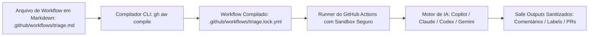

# Pipelines Agênticos: O Framework GitHub Agentic Workflows (`gh-aw`)

> A nova fronteira da automação no GitHub: descrevendo fluxos de trabalho com IA em Markdown e linguagem natural, compilados de forma segura para GitHub Actions.

---

## 1. O Que É o GitHub Agentic Workflows (`gh-aw`)?

* **Repositório:** [`github/gh-aw`](https://github.com/github/gh-aw)
* **Desenvolvido por:** GitHub Next, Microsoft Research e Azure Core Upstream.
* **Proposta de Valor:** Permitir que tarefas de raciocínio, manutenção de repositório, revisão qualitativa de código e triagem sejam orquestradas como **workflows nativos de IA dentro do GitHub Actions**, sem necessidade de programar integrações complexas de API.



---

## 2. Divisão de Responsabilidades: Determinístico vs. Agêntico

No ecossistema moderno de CI/CD:

| Tipo de Tarefa | Abordagem Recomendada | Exemplo |
| :--- | :--- | :--- |
| **Determinística** | GitHub Actions clássico em **YAML** | Compilar binários, rodar testes unitários, build Docker, linter `actionlint` |
| **Agêntica (Raciocínio)** | GitHub Agentic Workflows em **Markdown** (`gh-aw`) | Análise semântica de falhas de CI, revisão arquitetural de PRs, classificação de issues |

---

## 3. Estrutura de um Workflow Agêntico (`.md`)

O workflow é composto por um cabeçalho YAML delimitado por `---` (definindo metadados operacionais e limites de segurança) e um corpo em Markdown com as instruções contextuais:

### Exemplo: `triage-ci-failures.md`

```markdown
---
name: "Triagem Inteligente de Falhas de CI"
on:
  workflow_run:
    workflows: ["CI/CD Pipeline"]
    types: [completed]

permissions:
  contents: read
  issues: read

engine: "claude-3-7-sonnet" # ou copilot, codex, gemini

safe-outputs:
  - create-issue-comment
  - add-labels

tools:
  - github-mcp
---

# Missão do Agente

Você é um especialista em confiabilidade de sistemas (SRE) e diagnóstico de CI.
O workflow de CI/CD principal acabou de falhar.

## Tarefas a Executar

1. Inspecione os logs do job que falhou utilizando a ferramenta GitHub MCP.
2. Identifique se a falha decorre de:
   - **Flaky Test:** teste com timeout ou falha de concorrência intermitente.
   - **Erro de Compilação:** quebra de tipo ou sintaxe.
   - **Falha de Dependência:** pacote indisponível na rede.
3. Resuma a causa raiz em no máximo 3 tópicos concisos.
4. Gere um comentário claro no Pull Request associado, indicando exatamente a linha do erro e a sugestão de correção.
```

---

## 4. O Mecanismo de Segurança: Compilação e "Safe Outputs"

A maior preocupação ao executar agentes de IA em CI/CD é a segurança contra **Prompt Injection** (por exemplo, um atacante abrir uma issue contendo instruções que instruam o modelo a vazar segredos).

O `gh-aw` resolve isso com três pilares de defesa:

### 1. Compilação para `.lock.yml`:
O comando `gh aw compile` processa o arquivo `.md` e gera um arquivo `.lock.yml` padronizado e auditável. Ambos os arquivos são commitados no repositório. O GitHub Actions executa apenas o `.lock.yml`.

### 2. Execução Read-Only por Padrão:
O agente opera em um sandbox restrito com acesso apenas de leitura ao repositório. Ele **não possui permissão direta para chamar APIs de escrita do GitHub**.

### 3. Safe Outputs Sanitizados:
Se o agente decidir comentar em uma issue ou criar um branch, ele não executa essa chamada diretamente. Ele emite um payload estruturado JSON ("Safe Output"). Um passo determinístico final no `.lock.yml` (escrito e auditado pela equipe) valida o payload e executa a ação autorizada.

---

## 5. Integração com Model Context Protocol (MCP)

O `gh-aw` utiliza nativamente o **Model Context Protocol (MCP)** para conectar os agentes ao contexto vivo do repositório:
- Servidores MCP do GitHub fornecem ferramentas para ler diffs, commits, discussões de PRs e árvores de arquivos.
- Integração com o Agent Package Manager (APM) da Microsoft para importar bibliotecas de prompts, regras e skills reutilizáveis como dependências declaradas no frontmatter.

---

## 6. Como Começar com o `gh-aw`

### Instalação da Extensão da GitHub CLI:
```bash
gh extension install github/gh-aw
```

### Inicializando e Compilando um Workflow:
```bash
# Criar um novo workflow a partir de templates
gh aw init

# Compilar todos os workflows em Markdown para .lock.yml
gh aw compile

# Validar se os arquivos .lock.yml estão em sincronia antes do push
gh aw verify
```

