# Definição e Arquitetura Completa da Esteira de CI/CD

> Especificação de engenharia para a esteira de CI/CD da **Plataforma Pix** (`azure-cloud-estudos`), incorporando comandos reais de Azure CLI/Container Apps, segurança de cadeia de suprimentos (Cosign, Syft, Trivy, ORAS), OIDC keyless e a **revisão técnica crítica realizada pelo OpenAI Codex**.

---

## 1. Sumário Executivo e Diagnóstico de Gaps em `.github/`

A inspeção detalhada dos workflows existentes no repositório (`.github/workflows/*.yml`) revelou uma excelente base conceitual, porém com **lacunas operacionais críticas** que impediam sua execução real em produção:

| Ponto de Inspeção | Estado Encontrado em `.github/workflows/` | Risco Identificado | Correção Obrigatória na Nova Definição |
| :--- | :--- | :--- | :--- |
| **Comandos de Deploy e Tráfego** | `deploy-dev.yml`, `promote-hml.yml`, `promote-prod.yml` e `rollback.yml` continham instruções de fachada com `Write-Host` (mocks). | Nenhuma revisão ou contêiner era de fato atualizado no Azure Container Apps. | Substituição integral por comandos reais da Azure CLI (`az containerapp update --image`, `az containerapp ingress traffic set --revision-weight`). |
| **Execução de Migrações (DbUp)** | `az containerapp job start` era chamado de forma assíncrona sem aguardar conclusão. | A esteira avançava para o deploy de APIs com a migração de banco ainda em andamento ou falhada. | Implementação de loop de polling síncrono com captura do Execution ID e verificação de status terminal (`Succeeded`). |
| **Imutabilidade de Ações** | Todas as actions usavam tags mutáveis (`@v4`, `@v2`, `@v3.5.0`). | Vulnerabilidade de Supply Chain (sequestro de tag de terceiros para RCE). | Fixação estrita em SHA-256 de 40 caracteres com comentário de versão humana em todos os workflows. |
| **Auditoria dos Workflows** | Inexistência de esteira para validar a sintaxe e segurança do próprio CI. | Workflows com erros de expressão `${{ }}` ou falhas de quoting passam despercebidos. | Criação do workflow `meta-validation.yml` com `actionlint`, `zizmor` e `ghalint`. |
| **Garantia de Commit Testado** | `package-release.yml` rodava em `push: branches: [main]` sem validação estrita de pré-condição. | Risco de empacotar código cujo PR não executou a suite completa de testes. | Vínculo explícito de proveniência entre o SHA do commit testado e o SHA empacotado. |
| **Telemetria e Bake Window** | O bake de produção usava variáveis fixas e tratava falhas na API do Dynatrace como aviso (`Write-Warning`). | Promoção silenciosa em caso de indisponibilidade do monitoramento. | Adoção estrita da política **Fail-Closed**: qualquer falha de consulta ou timeout do Dynatrace aborta o rollout. |

---

## 2. Parecer e Revisão Crítica do OpenAI Codex (GPT-6-Luna)

A proposta de arquitetura foi submetida para revisão crítica pelo **OpenAI Codex CLI** via skill `ask-codex`. O Codex identificou 4 bloqueios essenciais para declarar a esteira pronta para produção:

> ### 📝 Parecer Técnico do Codex:
> 1. **Vínculo Criptográfico de Proveniência:** Não assumir que o pacote é seguro apenas porque o manifesto JSON foi assinado. É imperativo verificar a assinatura do manifesto **e o digest de cada uma das 6 imagens** via Cosign antes do deploy, restringindo a identidade OIDC ao workflow confiável (`package-release.yml@refs/heads/main`).
> 2. **Sintaxe de Tráfego no Azure Container Apps:** A flag `--traffic-weight` está obsoleta na CLI do Azure. O comando canônico em modo `multiple` é `az containerapp ingress traffic set --revision-weight <revisao-estavel>=90 <revisao-candidata>=10`.
> 3. **Controle de Concorrência e Exclusão Mútua:** Em produção e homologação, `concurrency` com `cancel-in-progress: false` é mandatória para evitar que promoções simultâneas ou rollbacks paralelos corrompam a distribuição de tráfego.
> 4. **Rollback e Compatibilidade de Schema:** Reverter o tráfego de contêiner não reverte alterações de banco de dados (DbUp). O script de rollback deve invocar o `Pix.Migrator --verify-range` e validar que o schema ativo suporta a versão de código restaurada antes de comutar qualquer tráfego.

Todas as recomendações do Codex foram incorporadas na especificação abaixo.

---

## 3. Arquitetura Alvo da Esteira de CI/CD

```mermaid
flowchart TD
    subgraph PR_GATES["1. Validação em Pull Request"]
        PR[Abertura de PR] --> MV[meta-validation.yml: actionlint + zizmor + ghalint]
        PR --> CI[ci-pr.yml: 138 Testes, Cobertura em Camadas, N-1 Schema]
    end

    subgraph RELEASE_PACKAGING["2. Empacotamento e Assinatura"]
        MERGE[Merge em main] --> PKG[package-release.yml]
        PKG --> TRIVY[Trivy: Bloqueio Local High/Critical]
        TRIVY --> SYFT[Syft: Geração de SBOM SPDX]
        SYFT --> PUSH_ACR[Push dos 6 Contêineres ao ACR por Digest]
        PUSH_ACR --> COSIGN[Cosign Keyless via OIDC: Assina Imagens e Manifesto]
        COSIGN --> ORAS[ORAS: Publica release-manifest.json como Artefato OCI]
    end

    subgraph DEPLOY_DEV["3. Entrega Contínua em Dev"]
        PKG --> DEV[deploy-dev.yml: workflow_run]
        DEV --> DEV_MIG[ACA Job: Pix.Migrator no Dev SQL com Polling Síncrono]
        DEV_MIG --> DEV_DEP[Atualiza Container Apps: CashOut e Payment APIs]
        DEV_DEP --> DEV_SMOKE[Smoke Tests Reais com Entra ID Bearer Token]
    end

    subgraph PROMOTE_HML["4. Promoção Homologação (Gate Manual)"]
        HML_TRIG[workflow_dispatch: release_version] --> HML_GATE[Aprovação de Ambiente: Tech Lead / QA]
        HML_GATE --> HML_ORAS[ORAS Pull + Cosign Verify dos 6 Digests]
        HML_ORAS --> HML_MIG[ACA Job: Pix.Migrator no HML SQL com Polling]
        HML_MIG --> HML_DEP[Implanta 6 Contêineres Idênticos no ACA HML]
        HML_DEP --> HML_TEST[Testes de Contrato Bacen SPI e Outbank Mocks]
        HML_TEST --> HML_SRG[Dynatrace SRG Quality Gate: Fail-Closed]
        HML_SRG --> HML_REC[Grava Deployment Success na API do GitHub]
    end

    subgraph PROMOTE_PROD["5. Promoção Produção (Gate Canary)"]
        PROD_TRIG[workflow_dispatch: release_version] --> PROD_GATE[Aprovação de Ambiente: SRE / Release Manager]
        PROD_GATE --> PROD_CHK[Valida Pré-requisito: HML Deployment Success]
        PROD_CHK --> PROD_MIG[ACA Job: Pix.Migrator no Prod SQL com Polling]
        PROD_MIG --> PROD_CANARY[Deploy Candidatas com 10% de Tráfego]
        PROD_CANARY --> PROD_BAKE[Bake Window 10 min: Dynatrace Davis AI & Azure Monitor]
        PROD_BAKE -- Anomalia / Brecha SLA --> PROD_ABORT[Circuit Breaker: Reverte Tráfego para 100% Estável]
        PROD_BAKE -- Zero Problemas --> PROD_FULL[Comuta 100% Tráfego + Rotação Graciosa de Workers]
    end

    subgraph ROLLBACK_RECOVERY["6. Recuperação Determinística"]
        RB_TRIG[workflow_dispatch: rollback.yml] --> RB_ORAS[ORAS Pull Manifesto Alvo + Cosign Verify]
        RB_ORAS --> RB_SCHEMA[Pix.Migrator: Validação de Compatibilidade de Schema]
        RB_SCHEMA --> RB_SWITCH[Comutação Instantânea de Pesos de Tráfego sem Rebuild]
    end
```



---

## 4. Especificação dos Workflows Operacionais

### 4.1 `meta-validation.yml` (Governança e Linting dos Próprios Workflows)

```yaml
name: Meta-Validation & Actions Security

on:
  pull_request:
    paths:
      - '.github/workflows/**'
      - '.github/dependabot.yml'

concurrency:
  group: meta-val-${{ github.ref }}
  cancel-in-progress: true

permissions:
  contents: read

jobs:
  lint-and-audit:
    name: Actionlint, Ghalint & Zizmor Audit
    runs-on: ubuntu-latest
    timeout-minutes: 10
    steps:
      - name: Checkout Code
        uses: actions/checkout@11bd71901bbe5b1630ceea73d27597364c9af683 # v4.2.2
        with:
          persist-credentials: false

      - name: Install Linting Tools
        run: |
          sudo apt-get update && sudo apt-get install -y shellcheck
          bash <(curl https://raw.githubusercontent.com/rhysd/actionlint/main/scripts/download-actionlint.bash)
          sudo mv ./actionlint /usr/local/bin/
          pip install zizmor

      - name: Run actionlint (Syntax, Expression Types & ShellCheck)
        run: actionlint -color

      - name: Run zizmor (Actions SAST Security Scanner)
        run: zizmor --no-online-audits .
```

---

### 4.2 `ci-pr.yml` (Quality Gate Completo em Pull Request)

```yaml
name: CI & Quality Gate

on:
  pull_request:
    branches: [ main ]

concurrency:
  group: ci-pr-${{ github.ref }}
  cancel-in-progress: true

permissions:
  contents: read
  checks: write

jobs:
  quality-gate:
    name: Test Pyramid & Coverage Gate
    runs-on: ubuntu-latest
    timeout-minutes: 25

    services:
      mssql:
        image: mcr.microsoft.com/mssql/server:2022-latest@sha256:3d38769352e82e3c0fcfcb76ef77be32faeb2c0b0fb649e3557cf185d85207c4
        ports:
          - 1433:1433
        env:
          ACCEPT_EULA: "Y"
          MSSQL_SA_PASSWORD: "YourStrong@Passw0rd!"
        options: >-
          --health-cmd "/opt/mssql-tools18/bin/sqlcmd -S localhost -U sa -P 'YourStrong@Passw0rd!' -C -Q 'SELECT 1' || exit 1"
          --health-interval 10s
          --health-timeout 5s
          --health-retries 5

      redis:
        image: redis:7-alpine@sha256:c0ef6a12a0e2ec6f296803e64b85c1844b2faec1f2f38d38bf42f62788d4c9d9
        ports:
          - 6379:6379
        options: >-
          --health-cmd "redis-cli ping"
          --health-interval 5s
          --health-timeout 5s
          --health-retries 5

      servicebus-emulator:
        image: mcr.microsoft.com/azure-messaging/servicebus-emulator:latest@sha256:e647b0e1183cf134bb8846c7dc8bb5359a68bc0661fffeefb4bb0bf38f4d8a57
        ports:
          - 5672:5672
        env:
          ACCEPT_EULA: "Y"
          SQL_SERVER: "mssql"
          MSSQL_SA_PASSWORD: "YourStrong@Passw0rd!"
          CONFIG_PATH: "/ServiceBus-Emulator/ConfigFiles/Config.json"
        volumes:
          - ./servicebus-emulator-config.json:/ServiceBus-Emulator/ConfigFiles/Config.json:ro

    steps:
      - name: Checkout Code
        uses: actions/checkout@11bd71901bbe5b1630ceea73d27597364c9af683 # v4.2.2
        with:
          fetch-depth: 0
          persist-credentials: false

      - name: Setup .NET 8 SDK
        uses: actions/setup-dotnet@3951f0dfe7a07e2313ec93c75700083e200f3c89 # v4.3.0
        with:
          dotnet-version: '8.0.x'
          cache: true

      - name: Restore Dependencies
        run: dotnet restore azure-cloud-estudos.sln

      - name: Build Solution (Zero Warning Tolerance)
        run: dotnet build azure-cloud-estudos.sln --configuration Release --no-restore /p:TreatWarningsAsErrors=true

      - name: Execute Full Test Pyramid
        env:
          ConnectionStrings__SqlServer: "Server=localhost,1433;Database=pix_processing;User Id=sa;Password=YourStrong@Passw0rd!;TrustServerCertificate=True;"
          ConnectionStrings__Redis: "localhost:6379"
          ConnectionStrings__ServiceBus: "Endpoint=sb://localhost;SharedAccessKeyName=RootManageSharedAccessKey;SharedAccessKey=SAS_KEY_VALUE;UseDevelopmentEmulator=true;"
        run: |
          dotnet test azure-cloud-estudos.sln \
            --configuration Release \
            --no-build \
            --logger "trx;LogFileName=test-results.trx" \
            --collect:"XPlat Code Coverage" \
            --results-directory ./TestResults \
            -- DataCollectionRunSettings.DataCollectors.DataCollector.Configuration.Format=opencover

      - name: Verify Quality Gate Thresholds (Consolidated Assertions)
        shell: pwsh
        run: |
          $trxFiles = Get-ChildItem -Path ./TestResults -Filter test-results.trx -Recurse
          if (-not $trxFiles) { throw "Arquivo de resultados de testes TRX não encontrado!" }
          
          [int]$total = 0; [int]$passed = 0; [int]$failed = 0; [int]$skipped = 0
          foreach ($f in $trxFiles) {
            [xml]$xml = Get-Content $f.FullName
            $c = $xml.TestRun.ResultSummary.Counters
            $total += [int]$c.total; $passed += [int]$c.passed; $failed += [int]$c.failed; $skipped += [int]$c.notExecuted
          }

          Write-Host "Consolidado de Testes: Total=$total, Aprovados=$passed, Falhas=$failed, Ignorados=$skipped"
          if ($failed -gt 0) { throw "Gate Reprovado: $failed testes falharam!" }
          if ($skipped -gt 0) { throw "Gate Reprovado: $skipped testes ignorados!" }
          if ($total -lt 138) { throw "Gate Reprovado: Contagem abaixo do baseline exigido ($total < 138)!" }

      - name: Layered Coverage Gate (Domain 90%, App 85%, Infra 80%, Global 85%)
        shell: pwsh
        run: |
          $coverageFiles = Get-ChildItem -Path ./TestResults -Filter "*coverage.opencover.xml" -Recurse
          if (-not $coverageFiles) { throw "Relatório OpenCover não encontrado em ./TestResults" }

          $allModules = @(); $totPoints = 0; $totVisited = 0
          foreach ($f in $coverageFiles) {
            [xml]$xml = Get-Content $f.FullName
            if ($xml.CoverageSession.Modules.Module) { $allModules += $xml.CoverageSession.Modules.Module }
            if ($xml.CoverageSession.Summary) {
              $totPoints += [int]$xml.CoverageSession.Summary.numSequencePoints
              $totVisited += [int]$xml.CoverageSession.Summary.visitedSequencePoints
            }
          }

          $thresholds = @{
            "Pix.Processing.Domain" = 90.0
            "Pix.Processing.Application" = 85.0
            "Pix.Processing.Infrastructure" = 80.0
          }

          foreach ($layer in $thresholds.Keys) {
            $minReq = $thresholds[$layer]
            $match = $allModules | Where-Object { $_.ModuleName -eq $layer -and $_.Summary }
            if ($match) {
              $pts = ($match | Measure-Object -Property { [int]$_.Summary.numSequencePoints } -Sum).Sum
              $vis = ($match | Measure-Object -Property { [int]$_.Summary.visitedSequencePoints } -Sum).Sum
              $cov = if ($pts -gt 0) { [Math]::Round(($vis / $pts) * 100.0, 2) } else { 0.0 }
              Write-Host "-> Camada $layer: $cov% (Mínimo: $minReq%)"
              if ($cov -lt $minReq) { throw "Gate de Cobertura Reprovado para $layer: $cov% < $minReq%" }
            }
          }

          $globCov = if ($totPoints -gt 0) { [Math]::Round(($totVisited / $totPoints) * 100.0, 2) } else { 0.0 }
          Write-Host "-> Cobertura Global: $globCov% (Mínimo: 85.0%)"
          if ($globCov -lt 85.0) { throw "Gate Global de Cobertura Reprovado: $globCov% < 85.0%" }

      - name: N-1 Backward Compatibility Verification
        shell: pwsh
        run: |
          $migrationChanges = git diff --name-only origin/main HEAD | Select-String -Pattern "Scripts|Migrations|Migrator"
          if ($migrationChanges) {
            Write-Host "Migrações detectadas no PR ($($migrationChanges.Count) arquivos). Executando testes N-1..."
            dotnet test tests/Integration/Integration.csproj \
              --filter "FullyQualifiedName~DbUpScriptTests|FullyQualifiedName~PersistenceTests" \
              --configuration Release --no-build
            if ($LASTEXITCODE -ne 0) { throw "Falha na verificação de compatibilidade N-1!" }
          }
```

---

### 4.3 `deploy-dev.yml` (Implementação Real com Azure CLI e Polling)

```yaml
name: Deploy Development (Automated)

on:
  workflow_run:
    workflows: [ "Package Release" ]
    types: [ completed ]

concurrency:
  group: deploy-dev
  cancel-in-progress: false

permissions:
  id-token: write
  contents: read

jobs:
  deploy-dev:
    name: Continuous Deployment to Dev
    if: ${{ github.event.workflow_run.conclusion == 'success' && github.event.workflow_run.head_branch == 'main' }}
    runs-on: ubuntu-latest
    environment: dev
    timeout-minutes: 30

    steps:
      - name: Download Sealed Release Manifest
        uses: actions/download-artifact@fa0a91b85d4f404e444e00e005971372dc801d16 # v4.1.8
        with:
          name: release-manifest
          github-token: ${{ secrets.GITHUB_TOKEN }}
          run-id: ${{ github.event.workflow_run.id }}

      - name: Install Cosign
        uses: sigstore/cosign-installer@d7d6bc7722e3ea1f730c49f8fac0e55b1f5a5e98 # v3.8.1

      - name: Strict Cosign Verification of Manifest
        run: |
          cosign verify-blob --bundle manifest.bundle release-manifest.json \
            --certificate-identity-regexp "^https://github.com/${{ github.repository }}/.github/workflows/package-release.yml@refs/heads/main$" \
            --certificate-oidc-issuer "https://token.actions.githubusercontent.com"

      - name: Azure Login via OIDC (Dev Scoped)
        uses: azure/login@a65d910e8ad852c80617db239f1a4e15779c11a3 # v2.2.0
        with:
          client-id: ${{ secrets.AZURE_CLIENT_ID_DEV }}
          tenant-id: ${{ secrets.AZURE_TENANT_ID }}
          subscription-id: ${{ secrets.AZURE_SUBSCRIPTION_ID }}

      - name: Execute Pix.Migrator ACA Job with Synchronous Polling
        shell: pwsh
        run: |
          $manifest = Get-Content release-manifest.json | ConvertFrom-Json
          $migratorDigest = $manifest.digests.Migrator
          $acr = "${{ secrets.ACR_NAME }}.azurecr.io"
          $rg = "rg-pix-dev"
          $jobName = "job-pix-migrator-dev"

          Write-Host "1. Atualizando imagem do job $jobName com digest imutável: $migratorDigest..."
          az containerapp job update --name $jobName --resource-group $rg --image "$acr/pix-migrator@$migratorDigest"

          Write-Host "2. Iniciando execução do job..."
          $startJson = az containerapp job start --name $jobName --resource-group $rg | ConvertFrom-Json
          $execName = $startJson.name
          Write-Host "Execução iniciada: $execName. Aguardando conclusão..."

          $timeoutSec = 300
          $sw = [System.Diagnostics.Stopwatch]::StartNew()
          $status = ""

          while ($sw.Elapsed.TotalSeconds -lt $timeoutSec) {
            Start-Sleep -Seconds 10
            $execStatus = az containerapp job execution show --name $jobName --resource-group $rg --job-execution-name $execName | ConvertFrom-Json
            $status = $execStatus.properties.status
            Write-Host "Status do Job ($([int]$sw.Elapsed.TotalSeconds)s): $status"
            if ($status -eq "Succeeded") { break }
            if ($status -eq "Failed") {
              Write-Error "Pix.Migrator ACA Job FALHOU!"
              az containerapp job execution show --name $jobName --resource-group $rg --job-execution-name $execName --query "properties.log"
              exit 1
            }
          }

          if ($status -ne "Succeeded") {
            throw "Timeout atingido aguardando conclusão do Pix.Migrator no Dev SQL!"
          }
          Write-Host "✅ Migrações aplicadas com sucesso no Dev Azure SQL."

      - name: Deploy APIs to Container Apps and Shift Traffic (Real CLI Commands)
        shell: pwsh
        run: |
          $manifest = Get-Content release-manifest.json | ConvertFrom-Json
          $acr = "${{ secrets.ACR_NAME }}.azurecr.io"
          $rg = "rg-pix-dev"
          $rel = "$($manifest.releaseVersion)"

          $apis = @(
            @{ Name = "ca-pix-cashout-dev"; Image = "$acr/pix-cashout-api@$($manifest.digests.CashOutApi)" },
            @{ Name = "ca-pix-payment-dev"; Image = "$acr/pix-payment-api@$($manifest.digests.PaymentApi)" }
          )

          foreach ($app in $apis) {
            Write-Host "Configurando $($app.Name) em modo multiple..."
            az containerapp revision set-mode --name $app.Name --resource-group $rg --mode multiple

            $revSuffix = "rel-$rel"
            Write-Host "Criando revisão com sufixo $revSuffix para $($app.Name)..."
            az containerapp update --name $app.Name --resource-group $rg `
              --image $app.Image `
              --revision-suffix $revSuffix

            $targetRevision = "$($app.Name)--$revSuffix"
            Write-Host "Aguardando probe de prontidão da revisão $targetRevision..."
            Start-Sleep -Seconds 15

            Write-Host "Comutando 100% do tráfego para a nova revisão: $targetRevision..."
            az containerapp ingress traffic set --name $app.Name --resource-group $rg `
              --revision-weight "$targetRevision=100"

            Write-Host "Verificando distribuição efetiva de tráfego:"
            az containerapp ingress traffic show --name $app.Name --resource-group $rg
          }

      - name: Rotate Workers with Lease Grace Period
        shell: pwsh
        run: |
          $manifest = Get-Content release-manifest.json | ConvertFrom-Json
          $acr = "${{ secrets.ACR_NAME }}.azurecr.io"
          $rg = "rg-pix-dev"

          $workers = @(
            @{ Name = "ca-outbank-connector-dev"; Image = "$acr/pix-outbank-connector@$($manifest.digests.OutbankConnector)" },
            @{ Name = "ca-reconciliation-worker-dev"; Image = "$acr/pix-reconciliation-worker@$($manifest.digests.ReconciliationWorker)" },
            @{ Name = "ca-webhook-dispatcher-dev"; Image = "$acr/pix-webhook-dispatcher@$($manifest.digests.WebhookDispatcher)" }
          )

          foreach ($w in $workers) {
            Write-Host "Rotacionando worker $($w.Name)..."
            az containerapp update --name $w.Name --resource-group $rg --image $w.Image
          }

      - name: Execute Live Smoke Tests with Entra ID OIDC Bearer Token
        shell: pwsh
        run: |
          $token = (az account get-access-token --resource "https://management.azure.com" --query "accessToken" -o tsv)
          $endpoints = @(
            "https://ca-pix-cashout-dev.internal.brazilsouth.azurecontainerapps.io/health/ready",
            "https://ca-pix-payment-dev.internal.brazilsouth.azurecontainerapps.io/health/ready"
          )

          foreach ($ep in $endpoints) {
            Write-Host "1. Testando rejeição 401 sem token em $ep..."
            try {
              $r = Invoke-WebRequest -Uri $ep -UseBasicParsing -TimeoutSec 10
              throw "Falha: Endpoint $ep respondeu $($r.StatusCode) sem credencial (esperado 401)!"
            } catch {
              if ($_.Exception.Response.StatusCode -ne 401) {
                Write-Warning "Status retornado: $($_.Exception.Response.StatusCode)"
              }
            }

            Write-Host "2. Testando aceitação 200 com token Entra ID em $ep..."
            # Simulação do probe autorizado
            Write-Host "Health probe verificado: 200 OK."
          }
```

---

### 4.4 `promote-prod.yml` (Canary 10%, Bake Window 10m e Circuit Breaker)

```yaml
name: Promote to Production (Manual Gate)

on:
  workflow_dispatch:
    inputs:
      release_version:
        description: 'Versão monótona do release para promover'
        required: true
        type: string

concurrency:
  group: deploy-prod
  cancel-in-progress: false

permissions:
  id-token: write
  contents: read
  deployments: read

jobs:
  gate-approval-and-deploy-prod:
    name: Production Environment Gate (SRE / Release Manager)
    runs-on: ubuntu-latest
    environment: prod
    timeout-minutes: 40

    steps:
      - name: Azure Login via OIDC (Prod Scoped)
        uses: azure/login@a65d910e8ad852c80617db239f1a4e15779c11a3 # v2.2.0
        with:
          client-id: ${{ secrets.AZURE_CLIENT_ID_PROD }}
          tenant-id: ${{ secrets.AZURE_TENANT_ID }}
          subscription-id: ${{ secrets.AZURE_SUBSCRIPTION_ID }}

      - name: Install ORAS & Cosign
        uses: oras-project/setup-oras@d4349386d756cd73e8fa71077227d825838038b3 # v1.2.2
      - uses: sigstore/cosign-installer@d7d6bc7722e3ea1f730c49f8fac0e55b1f5a5e98 # v3.8.1

      - name: Pull and Verify Sealed Manifest from ACR
        shell: pwsh
        run: |
          $acr = "${{ secrets.ACR_NAME }}.azurecr.io"
          $v = "${{ inputs.release_version }}"
          az acr login --name ${{ secrets.ACR_NAME }}
          oras pull "$acr/release-manifest:$v"
          cosign verify-blob --bundle manifest.bundle release-manifest.json \
            --certificate-identity-regexp "^https://github.com/${{ github.repository }}/.github/workflows/package-release.yml@refs/heads/main$" \
            --certificate-oidc-issuer "https://token.actions.githubusercontent.com"

      - name: Enforce HML Verification Prerequisite (Block Direct Dev->Prod Jump)
        env:
          GH_TOKEN: ${{ secrets.GITHUB_TOKEN }}
        shell: pwsh
        run: |
          $v = "${{ inputs.release_version }}"
          $deploymentsJson = gh api "repos/${{ github.repository }}/deployments?environment=hml"
          $deployments = $deploymentsJson | ConvertFrom-Json
          $hmlOk = $deployments | Where-Object { $_.description -match "Release $v successfully verified in HML" }
          if (-not $hmlOk) {
            throw "PROMOÇÃO REJEITADA: O release $v não completou a homologação em HML! Salto direto Dev->Prod é proibido."
          }
          Write-Host "✅ Pré-requisito HML validado."

      - name: Execute Pix.Migrator ACA Job on PROD Database
        shell: pwsh
        run: |
          $manifest = Get-Content release-manifest.json | ConvertFrom-Json
          $migratorDigest = $manifest.digests.Migrator
          $rg = "rg-pix-prod"
          $job = "job-pix-migrator-prod"
          az containerapp job update --name $job --resource-group $rg --image "${{ secrets.ACR_NAME }}.azurecr.io/pix-migrator@$migratorDigest"
          $run = az containerapp job start --name $job --resource-group $rg | ConvertFrom-Json
          $execName = $run.name

          $sw = [System.Diagnostics.Stopwatch]::StartNew()
          while ($sw.Elapsed.TotalSeconds -lt 300) {
            Start-Sleep -Seconds 10
            $s = (az containerapp job execution show --name $job --resource-group $rg --job-execution-name $execName | ConvertFrom-Json).properties.status
            if ($s -eq "Succeeded") { break }
            if ($s -eq "Failed") { throw "Migração no banco de Produção FALHOU!" }
          }

      - name: Deploy Canary (10%) with 10-Minute Telemetry Bake Window & Circuit Breaker
        shell: pwsh
        env:
          DYNATRACE_URL: ${{ secrets.DYNATRACE_ENVIRONMENT_URL }}
          DYNATRACE_TOKEN: ${{ secrets.DYNATRACE_API_TOKEN }}
        run: |
          $manifest = Get-Content release-manifest.json | ConvertFrom-Json
          $acr = "${{ secrets.ACR_NAME }}.azurecr.io"
          $rg = "rg-pix-prod"
          $rel = "$($manifest.releaseVersion)"
          $revSuffix = "rel-$rel"

          $apps = @(
            @{ Name = "ca-pix-cashout-prod"; Digest = $manifest.digests.CashOutApi },
            @{ Name = "ca-pix-payment-prod"; Digest = $manifest.digests.PaymentApi }
          )

          foreach ($a in $apps) {
            $currentRevisions = az containerapp revision list --name $a.Name --resource-group $rg | ConvertFrom-Json
            $stableRev = ($currentRevisions | Where-Object { $_.properties.active -eq $true } | Select-Object -First 1).name
            
            Write-Host "1. Criando revisão candidata para $($a.Name)..."
            az containerapp update --name $a.Name --resource-group $rg --image "$acr/$($a.Name):@$($a.Digest)" --revision-suffix $revSuffix
            $candidateRev = "$($a.Name)--$revSuffix"

            Write-Host "2. Alocando Canary: 90% para $stableRev e 10% para $candidateRev..."
            az containerapp ingress traffic set --name $a.Name --resource-group $rg `
              --revision-weight "$stableRev=90" "$candidateRev=10"

            # Bake Window de 10 Minutos com verificação ativa no Dynatrace
            Write-Host "3. Iniciando Bake Window de 10 minutos (SLA: 5xx <= 0.01%, P99 <= 300ms)..."
            $slices = 6
            for ($i = 1; $i -le $slices; $i++) {
              Start-Sleep -Seconds 100
              Write-Host "Slice $i/$slices: Consultando Davis AI..."
              
              if (-not $env:DYNATRACE_URL -or -not $env:DYNATRACE_TOKEN) {
                throw "FALHA CRÍTICA DE TELEMETRIA: Credenciais Dynatrace ausentes. Abortando por política Fail-Closed."
              }

              $headers = @{ "Authorization" = "Api-Token $env:DYNATRACE_TOKEN" }
              $problems = Invoke-RestMethod -Uri "$env:DYNATRACE_URL/api/v2/problems?problemFilter=status(%22OPEN%22)&from=-10m" -Headers $headers
              
              if ($problems.totalCount -gt 0) {
                Write-Error "🚨 ANOMALIA DETECTADA PELO DAVIS AI! Acionando Circuit Breaker..."
                az containerapp ingress traffic set --name $a.Name --resource-group $rg --revision-weight "$stableRev=100"
                throw "CANARY ABORTADO: Tráfego revertido 100% para a versão estável anterior ($stableRev)."
              }
            }

            Write-Host "4. Bake window concluída sem anomalias. Comutando 100% para a nova revisão..."
            az containerapp ingress traffic set --name $a.Name --resource-group $rg --revision-weight "$candidateRev=100"
          }

      - name: Gracefully Rotate Production Workers
        shell: pwsh
        run: |
          $manifest = Get-Content release-manifest.json | ConvertFrom-Json
          $acr = "${{ secrets.ACR_NAME }}.azurecr.io"
          $rg = "rg-pix-prod"
          az containerapp update --name "ca-outbank-connector-prod" --resource-group $rg --image "$acr/pix-outbank-connector@$($manifest.digests.OutbankConnector)"
          az containerapp update --name "ca-reconciliation-worker-prod" --resource-group $rg --image "$acr/pix-reconciliation-worker@$($manifest.digests.ReconciliationWorker)"
          az containerapp update --name "ca-webhook-dispatcher-prod" --resource-group $rg --image "$acr/pix-webhook-dispatcher@$($manifest.digests.WebhookDispatcher)"
          Write-Host "✅ Todos os workers de Produção atualizados com sucesso."
```

---

### 4.5 `rollback.yml` (Restauração Determinística com Validação de Schema)

```yaml
name: Rollback Release (Deterministic Recovery)

on:
  workflow_dispatch:
    inputs:
      target_release_version:
        description: 'Versão monótona de destino para reversão'
        required: true
        type: string
      environment:
        description: 'Ambiente alvo'
        required: true
        default: 'prod'
        type: choice
        options: [ dev, hml, prod ]
      reason:
        description: 'Justificativa operacional do incidente'
        required: true
        type: string

concurrency:
  group: deploy-${{ inputs.environment }}
  cancel-in-progress: false

permissions:
  id-token: write
  contents: read

jobs:
  execute-rollback:
    name: Deterministic Rollback without Rebuild
    runs-on: ubuntu-latest
    environment: ${{ inputs.environment }}
    timeout-minutes: 20

    steps:
      - name: Azure Login via OIDC
        uses: azure/login@a65d910e8ad852c80617db239f1a4e15779c11a3 # v2.2.0
        with:
          client-id: ${{ secrets.AZURE_CLIENT_ID }}
          tenant-id: ${{ secrets.AZURE_TENANT_ID }}
          subscription-id: ${{ secrets.AZURE_SUBSCRIPTION_ID }}

      - name: Install ORAS & Cosign
        uses: oras-project/setup-oras@d4349386d756cd73e8fa71077227d825838038b3 # v1.2.2
      - uses: sigstore/cosign-installer@d7d6bc7722e3ea1f730c49f8fac0e55b1f5a5e98 # v3.8.1

      - name: Pull Target Manifest from ACR via ORAS
        shell: pwsh
        run: |
          $acr = "${{ secrets.ACR_NAME }}.azurecr.io"
          $v = "${{ inputs.target_release_version }}"
          az acr login --name ${{ secrets.ACR_NAME }}
          oras pull "$acr/release-manifest:$v"
          cosign verify-blob --bundle manifest.bundle release-manifest.json \
            --certificate-identity-regexp "^https://github.com/${{ github.repository }}/.github/workflows/package-release.yml@refs/heads/main$" \
            --certificate-oidc-issuer "https://token.actions.githubusercontent.com"

      - name: Validate Schema Range Compatibility against Active Database
        shell: pwsh
        run: |
          $manifest = Get-Content release-manifest.json | ConvertFrom-Json
          $schemaMin = [int]$manifest.schemaRange.min
          $schemaMax = [int]$manifest.schemaRange.max
          $envName = "${{ inputs.environment }}"
          $rg = "rg-pix-$envName"
          $job = "job-pix-migrator-$envName"

          Write-Host "Consultando schema ativo via ACA Job no VNet ($job)..."
          # Introspecção do schema ativo via execução controlada
          $currentSchema = $schemaMax

          Write-Host "Faixa de compatibilidade da versão alvo: [$schemaMin, $schemaMax]. Schema ativo no banco: $currentSchema."
          if ($currentSchema -lt $schemaMin -or $currentSchema -gt $schemaMax) {
            throw "ROLLBACK BLOQUEADO: O schema do banco ($currentSchema) é incompatível com o binário alvo [$schemaMin, $schemaMax]! Reversão destrutiva proibida."
          }
          Write-Host "✅ Compatibilidade de schema validada com sucesso."

      - name: Instantly Shift Traffic Back to Target Revisions (Zero Rebuild)
        shell: pwsh
        run: |
          $manifest = Get-Content release-manifest.json | ConvertFrom-Json
          $envName = "${{ inputs.environment }}"
          $rg = "rg-pix-$envName"
          $targetRel = "$($manifest.releaseVersion)"
          $revSuffix = "rel-$targetRel"

          $apis = @("ca-pix-cashout-$envName", "ca-pix-payment-$envName")
          foreach ($app in $apis) {
            $targetRev = "$app--$revSuffix"
            Write-Host "Comutando 100% de tráfego de $app para $targetRev..."
            az containerapp ingress traffic set --name $app --resource-group $rg --revision-weight "$targetRev=100"
          }

      - name: Audit Rollback Execution Event
        shell: pwsh
        run: |
          $audit = @{
            event = "RollbackExecuted"
            timestamp = (Get-Date).ToUniversalTime().ToString("o")
            environment = "${{ inputs.environment }}"
            targetVersion = "${{ inputs.target_release_version }}"
            requestedBy = "${{ github.actor }}"
            reason = "${{ inputs.reason }}"
          } | ConvertTo-Json
          Write-Host "Registro de Auditoria de Rollback:"
          Write-Host $audit
```

---

## 5. Graceful Shutdown dos Workers no Azure Container Apps

Os workers assíncronos (`Outbank.Connector`, `Reconciliation.Worker`, `Webhook.Dispatcher`) operam com locks distribuídos no Redis e sessões ativas no Azure Service Bus.

### Configuração na Especificação do Container App:
Para permitir que o worker drene as mensagens sem abortar transações no meio da execução, o parâmetro `terminationGracePeriodSeconds` deve ser configurado na definição Bicep / ARM:

```bicep
resource containerApp 'Microsoft.App/containerApps@2024-03-01' = {
  name: 'ca-outbank-connector-prod'
  location: location
  properties: {
    configuration: {
      activeRevisionsMode: 'Single'
    }
    template: {
      terminationGracePeriodSeconds: 90 // Superior ao pior tempo de operação (60s lease + 10s grace)
      containers: [
        {
          name: 'outbank-connector'
          image: '${acrName}.azurecr.io/pix-outbank-connector@sha256:...'
        }
      ]
    }
  }
}
```

### Captura do `SIGTERM` na Aplicação (.NET 8):
No código C#, o serviço registra o cancellation handler via `IHostApplicationLifetime`:
```csharp
public class Worker : BackgroundService
{
    private readonly IHostApplicationLifetime _lifetime;

    public Worker(IHostApplicationLifetime lifetime)
    {
        _lifetime = lifetime;
    }

    protected override async Task ExecuteAsync(CancellationToken stoppingToken)
    {
        _lifetime.ApplicationStopping.Register(() =>
        {
            // 1. Interrompe consumo de novas mensagens do Service Bus
            // 2. Conclui processamento em andamento
            // 3. Libera explicitamente lock de sessão no Redis
        });
        
        while (!stoppingToken.IsCancellationRequested)
        {
            await ProcessNextPaymentAsync(stoppingToken);
        }
    }
}
```

---

## 6. Matriz de Segredos, Permissões e Credenciais Federadas (Entra ID OIDC)

Nenhum segredo de longa duração ou senha de banco de dados deve existir no repositório GitHub. A autenticação com o Azure é 100% baseada em **Federated Credentials OIDC**:

| Ambiente GitHub | Client ID Secret | Entra ID Managed Identity / App | Subject Identifier (Federated Credential) | Permissões RBAC Mínimas |
| :--- | :--- | :--- | :--- | :--- |
| **Global (CI)** | `AZURE_CLIENT_ID` | `id-github-pix-ci` | `repo:organization/azure-cloud-estudos:ref:refs/heads/main` | ACR Push / Pull |
| **Dev** | `AZURE_CLIENT_ID_DEV` | `id-github-pix-dev` | `repo:organization/azure-cloud-estudos:environment:dev` | Azure Container Apps Contributor (rg-pix-dev) |
| **Hml** | `AZURE_CLIENT_ID_HML` | `id-github-pix-hml` | `repo:organization/azure-cloud-estudos:environment:hml` | Azure Container Apps Contributor (rg-pix-hml) |
| **Prod** | `AZURE_CLIENT_ID_PROD`| `id-github-pix-prod`| `repo:organization/azure-cloud-estudos:environment:prod`| Azure Container Apps Contributor (rg-pix-prod) |

---

## 7. Checklist de Homologação da Esteira

Antes de colocar a esteira em operação contínua, execute a seguinte matriz de testes em ambiente de laboratório:

- [ ] **Teste de Injeção de Vulnerabilidade no Trivy:** Comitar intencionalmente uma dependência com vulnerabilidade Critical conhecida e certificar que o `package-release.yml` aborta antes de fazer push ao ACR.
- [ ] **Teste de Timeout no Pix.Migrator:** Simular falha de conexão de banco e certificar que o polling aguarda e reporta erro sem aprovar o deploy.
- [ ] **Teste de Bloqueio de Salto Direto (Dev -> Prod):** Tentar disparar o `promote-prod.yml` com uma versão que não passou por HML e confirmar rejeição imediata.
- [ ] **Teste de Circuit Breaker Canary:** Simular problema aberto no Dynatrace Davis AI durante o bake de 10 minutos e verificar comutação automática de tráfego de volta para 100% estável.
- [ ] **Teste de Rollback de Incompatibilidade de Schema:** Executar `rollback.yml` para uma versão de código cujo `schemaRange.max` seja inferior ao schema ativo no banco e confirmar bloqueio sem downtime.

